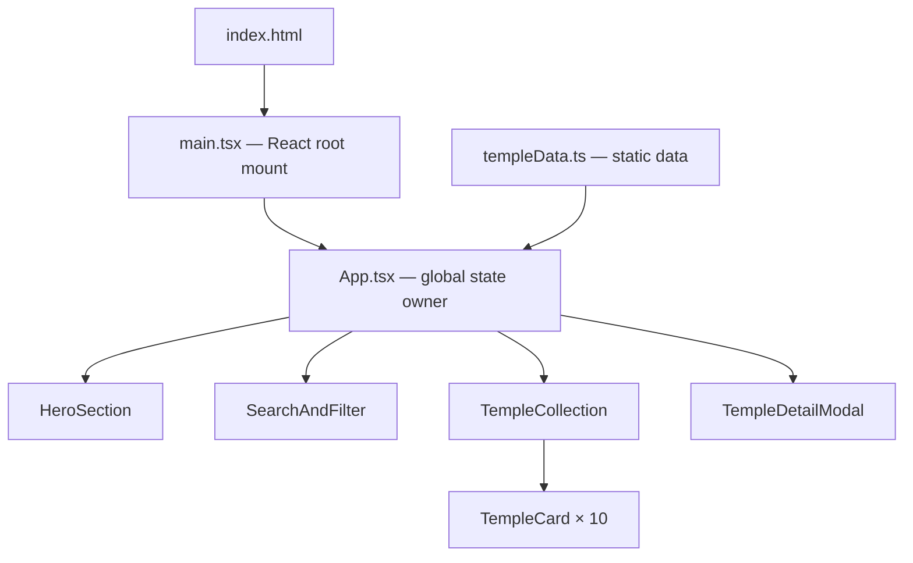

# Design Document — Pride Temples of Tamil Nadu

## Overview

"Pride Temples of Tamil Nadu" is a polished, single-page cultural showcase built with React + TypeScript + Vite. It presents 10 famous temples of Tamil Nadu through an interactive browsing experience — search, region filtering, and a detail modal — with no backend, no database, and no authentication.

The project is simultaneously a Kiro University 2026 portfolio piece, structured so that all seven Kiro lessons (spec-driven development, steering documents, hooks, property-based testing, powers, MCP, and custom agents) are concretely demonstrated within the codebase.

### Goals

- Deliver a visually impressive, fully responsive cultural website in one day.
- Keep the codebase small, readable, and easy to walk through during a presentation.
- Demonstrate every Kiro lesson with a real, working artefact — not a placeholder.

### Non-Goals

- No backend, API, or database.
- No user authentication or personalisation.
- No server-side rendering.
- No CI/CD pipeline (out of scope for one-day build).

---

## Architecture

The application is a pure client-side SPA rendered into a single `index.html`. There is no router — all "navigation" is handled through React state (selected temple, open modal, active filters). The entire data set is a static TypeScript module imported at build time.



**State flows top-down from `App.tsx`.** User interactions (search input, filter selection, card click) bubble up via callbacks. No external state library is needed at this scale.

---

## Technology Stack

| Concern | Choice | Justification |
|---|---|---|
| Framework | React 18 + TypeScript | Industry standard; strong typing for temple data model; excellent Vite integration |
| Build tool | Vite 5 | Sub-second HMR; minimal config; produces optimised bundles |
| Styling | Tailwind CSS v3 | Utility-first keeps component files self-contained; no CSS naming conflicts; purge = small bundle |
| Animations | Framer Motion | Declarative `motion.*` components; `useReducedMotion` hook handles accessibility automatically |
| Testing | Vitest + React Testing Library | First-class Vite integration; identical API to Jest; co-located tests |
| Property tests | fast-check | Mature JS PBT library; integrates with Vitest via `fc.assert` / `fc.property` |
| Linting | ESLint + TypeScript ESLint | Catch type errors early |

**Runtime dependency count:** React, ReactDOM, Framer Motion, Tailwind CSS (PostCSS plugin) = **4 direct runtime packages** — well within the ≤ 10 limit.

---

## Components and Interfaces

### Component Hierarchy

```
App
├── HeroSection
├── SearchAndFilter
│   ├── SearchBar
│   └── RegionFilter
├── TempleCollection
│   └── TempleCard (×0–10)
└── TempleDetailModal
```

### Component Responsibilities

#### `App.tsx`
- Imports `templeData` from the static data module.
- Owns state: `searchQuery: string`, `activeRegion: RegionKey`, `selectedTemple: Temple | null`.
- Derives `filteredTemples` via a pure `filterTemples()` function (no side effects — enables property testing).
- Passes `filteredTemples` down to `TempleCollection`.
- Passes `selectedTemple` and a `onClose` handler to `TempleDetailModal`.
- Manages `document.body.style.overflow` when modal opens/closes.

#### `HeroSection.tsx`
- Purely presentational — no props required.
- Renders heading, tagline, and a smooth-scroll CTA button.
- Full-width gradient background using Tailwind classes (no external image dependency for the hero — reduces load time).

#### `SearchAndFilter.tsx`
- Receives `searchQuery`, `activeRegion`, and callbacks `onSearchChange`, `onRegionChange`.
- Renders `SearchBar` and `RegionFilter` as children.
- Stateless — all filter state lives in `App`.

#### `SearchBar.tsx`
- Controlled input; calls `onSearchChange` on every keystroke.
- Has `aria-label="Search temples by name or location"`.

#### `RegionFilter.tsx`
- Renders tab buttons for the four filter options: `All | Chola | Pandya/Nayak | Other`.
- Applies active styling to the currently selected option.
- Has `role="group"` and `aria-label="Filter by region or dynasty"`.

#### `TempleCollection.tsx`
- Receives `filteredTemples: Temple[]` and `onSelectTemple: (temple: Temple) => void`.
- Renders a responsive grid of `TempleCard` components.
- Renders the "No temples found" empty state when `filteredTemples.length === 0`.

#### `TempleCard.tsx`
- Receives a single `temple: Temple` and `onClick` callback.
- Renders image (with `alt`), name, location, dynasty badge, and short description.
- Wrapped in a Framer Motion `motion.div` for viewport entrance animation and hover effect.
- Passes keyboard `onKeyDown` handler to support Enter/Space activation (accessibility).

#### `TempleDetailModal.tsx`
- Receives `temple: Temple | null` and `onClose: () => void`.
- Renders `null` when `temple` is `null` (closed state).
- Contains a focus trap (via `useEffect` + `tabIndex` management or a lightweight utility).
- Listens for `Escape` key via `useEffect`.
- Renders full temple detail: name, location, founding period, dynasty, architectural style, detailed history, notable features list, significance, and large image.
- Handles the error case when the temple object is unexpectedly malformed.

---

## Data Models

### `Temple` Interface

```typescript
export type RegionKey = 'Chola' | 'Pandya/Nayak' | 'Other';

export interface Temple {
  id: string;                    // Unique slug, e.g. "brihadeeswarar"
  name: string;                  // Full temple name
  location: string;              // City/town name
  district: string;              // Tamil Nadu district
  region: RegionKey;             // Used by RegionFilter
  dynasty: string;               // E.g. "Chola", "Nayak", "Pallava"
  foundingPeriod: string;        // Human-readable, e.g. "11th century CE"
  architecturalStyle: string;    // E.g. "Dravidian", "Vijayanagara"
  shortDescription: string;      // ≤ 40 words — shown on TempleCard
  detailedHistory: string;       // ≥ 60 words — shown in modal
  notableFeatures: string[];     // Bullet-list items in modal
  significance: string;          // Cultural/religious significance paragraph
  imageUrl: string;              // Relative path or Unsplash URL
  imageAlt: string;              // Descriptive alt text (separate from name for screen readers)
}
```

> **Note on `imageAlt`:** The interface includes a dedicated `imageAlt` field so alt text is data-driven rather than hard-coded in components. This also makes the property-based test for alt text straightforward.

### Temple Record List (IDs)

| ID | Temple | Region |
|---|---|---|
| `brihadeeswarar` | Brihadeeswarar Temple, Thanjavur | Chola |
| `meenakshi-amman` | Meenakshi Amman Temple, Madurai | Pandya/Nayak |
| `shore-temple` | Shore Temple, Mahabalipuram | Other |
| `ramanathaswamy` | Ramanathaswamy Temple, Rameswaram | Other |
| `airavatesvara` | Airavatesvara Temple, Darasuram | Chola |
| `gangaikonda-cholapuram` | Gangaikonda Cholapuram Temple | Chola |
| `ekambareswarar` | Ekambareswarar Temple, Kanchipuram | Other |
| `jambukeswarar` | Jambukeswarar Temple, Tiruchirappalli | Other |
| `ranganathaswamy` | Ranganathaswamy Temple, Srirangam | Other |
| `murugan-tiruchendur` | Murugan Temple, Tiruchendur | Pandya/Nayak |

### `FilterState` (internal to App)

```typescript
interface FilterState {
  searchQuery: string;
  activeRegion: RegionKey | 'All';
}
```

### Pure Filter Function

```typescript
// src/utils/filterTemples.ts
export function filterTemples(
  temples: Temple[],
  query: string,
  region: RegionKey | 'All'
): Temple[] {
  const q = query.trim().toLowerCase();
  return temples.filter((t) => {
    const matchesSearch =
      q === '' ||
      t.name.toLowerCase().includes(q) ||
      t.location.toLowerCase().includes(q);
    const matchesRegion = region === 'All' || t.region === region;
    return matchesSearch && matchesRegion;
  });
}
```

This function is pure (no side effects, deterministic) — it is the primary target for property-based tests.

---

## State Management

No external state library (Redux, Zustand, Jotai) is needed. All state lives in `App.tsx` using `useState`:

```typescript
const [searchQuery, setSearchQuery]   = useState('');
const [activeRegion, setActiveRegion] = useState<RegionKey | 'All'>('All');
const [selectedTemple, setSelectedTemple] = useState<Temple | null>(null);
```

`filteredTemples` is derived synchronously:

```typescript
const filteredTemples = filterTemples(templeData, searchQuery, activeRegion);
```

React re-renders automatically when state changes — no memoisation needed at this scale (10 temples, simple filter).

---

## Routing

No router is needed. The site has a single view. "Navigation" between states is modelled as:

- Modal open/close → `selectedTemple` state
- Hero CTA → `window.scrollTo()` / smooth-scroll CSS

If a URL-shareable modal state is needed in future, `URLSearchParams` can be added without a router library.

---

## Styling and Theming Strategy

### Heritage Colour Palette

```
--gold-primary:    #C8960C   (temple gopuram gold)
--gold-light:      #F2C94C   (highlight / accent)
--crimson:         #8B1A1A   (deep red — sacred colour)
--ivory:           #FAF3E0   (warm background)
--stone:           #5C4A32   (dark text on light bg — passes 4.5:1 contrast on ivory)
--stone-light:     #8C7355   (muted labels)
--teal-accent:     #1A6B6B   (Chola-era fresco teal — used sparingly)
```

### Typography

- **Headings:** `Cinzel` (Google Font — reminiscent of classical inscriptions)
- **Body:** `Lato` (clean, legible at small sizes on mobile)
- Both loaded via `@import` in `index.css` (no JS font-loader dependency).

### Tailwind Configuration

Custom theme tokens added to `tailwind.config.js`:

```js
colors: { gold: { ... }, crimson: { ... }, ivory: { ... }, stone: { ... } }
fontFamily: { display: ['Cinzel', 'serif'], body: ['Lato', 'sans-serif'] }
```

Tailwind's `screens` breakpoints align with requirements: `sm: 640px`, `lg: 1024px`.

---

## Animation Strategy

All animations use Framer Motion to ensure a single, consistent motion system.

### TempleCard Entrance (Viewport)

```typescript
// Wrapped in motion.div with whileInView
initial={{ opacity: 0, y: 24 }}
whileInView={{ opacity: 1, y: 0 }}
viewport={{ once: true }}
transition={{ duration: 0.4, ease: 'easeOut' }}
```

### TempleCard Hover

```typescript
whileHover={{ scale: 1.03, boxShadow: '0 8px 32px rgba(200,150,12,0.25)' }}
transition={{ duration: 0.2 }}
```

### Modal Open/Close

```typescript
// AnimatePresence wraps TempleDetailModal in App
initial={{ opacity: 0, scale: 0.95 }}
animate={{ opacity: 1, scale: 1 }}
exit={{ opacity: 0, scale: 0.95 }}
transition={{ duration: 0.25 }}
```

### Reduced Motion

Framer Motion's `useReducedMotion()` hook is called in `App.tsx`. When it returns `true`, all `transition` durations are overridden to `0` and `whileInView`/`whileHover` variants are replaced with static states.

```typescript
const reduceMotion = useReducedMotion();
const cardVariants = reduceMotion
  ? { hidden: {}, visible: {} }
  : { hidden: { opacity: 0, y: 24 }, visible: { opacity: 1, y: 0 } };
```

---

## Correctness Properties

*A property is a characteristic or behavior that should hold true across all valid executions of a system — essentially, a formal statement about what the system should do. Properties serve as the bridge between human-readable specifications and machine-verifiable correctness guarantees.*

The features in scope contain several pure functions (primarily `filterTemples`) and a structured data array (`templeData`) that are excellent candidates for property-based testing. UI rendering requirements that involve visual layout or aesthetics are excluded — those are verified by Lighthouse audits and visual review.

**Property reflection summary:** After reviewing all criteria, properties 2, 3, and 4 (search filter, region filter, and combined filter) all test the same underlying `filterTemples` function. Rather than writing three separate properties with overlapping generators, they are consolidated into:
- Property 2 (search correctness) — tests the search predicate in isolation
- Property 4 (combined filter correctness) — subsumes the region-only case (setting `query=''` in the combined test degenerates to the region-only case)

The remaining correctness properties (schema validation and alt text) are independent and non-redundant.

### Property 1: Temple_Card renders all required display fields

*For any* temple record in `templeData`, rendering a `TempleCard` with that record should produce an element containing the temple's name, location, dynasty, and a short description of no more than 40 words.

**Validates: Requirements 2.2**

---

### Property 2: Search filter returns only matching temples

*For any* non-empty search query `q` and any array of temple records, `filterTemples(temples, q, 'All')` should return only records where the temple's `name` or `location` contains `q` (case-insensitive). No matching temple should be excluded, and no non-matching temple should be included.

**Validates: Requirements 3.2**

---

### Property 3: Clearing the search restores the region-filtered set

*For any* region filter value `r` and any search query `q`, applying `filterTemples(temples, q, r)` then `filterTemples(temples, '', r)` should produce the same result as `filterTemples(temples, '', r)` applied from the start — i.e., clearing the search is a no-op on the region-filtered baseline.

**Validates: Requirements 3.4**

---

### Property 4: Combined filter satisfies both predicates simultaneously

*For any* search query `q` and region `r`, every temple returned by `filterTemples(temples, q, r)` must individually satisfy the search predicate (name/location contains `q`) AND the region predicate (`region === r` or `r === 'All'`). No temple satisfying both predicates should be absent from the result.

**Validates: Requirements 4.4, 3.2, 4.2**

---

### Property 5: Every temple record satisfies the full data schema

*For any* temple record `t` in `templeData`: all required fields (`id`, `name`, `location`, `district`, `region`, `dynasty`, `foundingPeriod`, `architecturalStyle`, `shortDescription`, `detailedHistory`, `notableFeatures`, `significance`, `imageUrl`, `imageAlt`) must be present, non-empty strings (or non-empty array for `notableFeatures`), `shortDescription` must be ≤ 40 words, `detailedHistory` must be ≥ 60 words, and `region` must be one of `'Chola' | 'Pandya/Nayak' | 'Other'`.

**Validates: Requirements 6.1, 6.2**

---

### Property 6: Every rendered temple image has a non-empty alt attribute

*For any* temple record `t`, rendering `TempleCard` with `t` and rendering `TempleDetailModal` with `t` should each produce exactly one `` element whose `alt` attribute is a non-empty string.

**Validates: Requirements 9.1**

---

### Property 7: Temple_Detail_Modal renders all required detail fields

*For any* temple record `t` in `templeData`, rendering `TempleDetailModal` with `t` should produce an element containing `t.name`, `t.location`, `t.dynasty`, `t.foundingPeriod`, `t.architecturalStyle`, `t.detailedHistory`, at least one notable feature, and `t.significance`.

**Validates: Requirements 5.2**

---

## Error Handling

| Scenario | Handling |
|---|---|
| `selectedTemple` is not found in `templeData` | `TempleDetailModal` renders an error message ("Temple details unavailable") and calls `console.error`. |
| `templeData` array is empty or malformed | `TempleCollection` renders the empty state message. App does not crash. |
| Image fails to load | `onError` on each `` swaps `src` to a local fallback SVG placeholder. |
| `filterTemples` receives empty array | Returns `[]` gracefully — no special case needed. |

No network errors are possible since there is no backend. All data is static.

---

## Testing Strategy

### Test Files Layout

```
src/
  utils/
    filterTemples.ts
    filterTemples.test.ts      ← unit + property tests for filter logic
  data/
    templeData.ts
    templeData.test.ts         ← property tests for data schema + alt text
  components/
    TempleCard/
      TempleCard.test.tsx      ← rendering example tests
    TempleDetailModal/
      TempleDetailModal.test.tsx
    HeroSection/
      HeroSection.test.tsx
```

### Unit Tests (Example-Based)

- `HeroSection` renders heading, tagline, and CTA link.
- `TempleCollection` renders 10 cards when no filters are active.
- `RegionFilter` renders all four option buttons.
- Clicking a `TempleCard` calls the `onSelectTemple` callback.
- `TempleDetailModal` closes on Escape key.
- `TempleDetailModal` renders error message for a malformed temple record.
- `filterTemples` with empty query + 'All' region returns all 10 temples.

### Property-Based Tests (fast-check)

Property tests use `fc.assert(fc.property(...))` with **100 iterations minimum** (fast-check default). Each test is tagged with its design property number.

**`filterTemples.test.ts`**

```typescript
// Feature: pride-temples-of-tamil-nadu, Property 2: Search filter returns only matching temples
it('search results all contain the query string (case-insensitive)', () => {
  fc.assert(
    fc.property(
      fc.string({ minLength: 1, maxLength: 20 }),
      (query) => {
        const results = filterTemples(templeData, query, 'All');
        return results.every(
          (t) =>
            t.name.toLowerCase().includes(query.toLowerCase()) ||
            t.location.toLowerCase().includes(query.toLowerCase())
        );
      }
    )
  );
});

// Feature: pride-temples-of-tamil-nadu, Property 3: Clearing search restores region-filtered set
it('clearing the search query after filtering restores the region-filtered baseline', () => {
  fc.assert(
    fc.property(
      fc.string({ maxLength: 20 }),
      fc.constantFrom('All', 'Chola', 'Pandya/Nayak', 'Other' as const),
      (query, region) => {
        const afterClear = filterTemples(templeData, '', region);
        const baseline   = filterTemples(templeData, '', region);
        return afterClear.length === baseline.length &&
               afterClear.every((t, i) => t.id === baseline[i].id);
      }
    )
  );
});

// Feature: pride-temples-of-tamil-nadu, Property 4: Combined filter satisfies both predicates
it('every result satisfies both search and region predicates', () => {
  fc.assert(
    fc.property(
      fc.string({ maxLength: 20 }),
      fc.constantFrom('All', 'Chola', 'Pandya/Nayak', 'Other' as const),
      (query, region) => {
        const results = filterTemples(templeData, query, region);
        return results.every((t) => {
          const q = query.trim().toLowerCase();
          const matchesSearch =
            q === '' ||
            t.name.toLowerCase().includes(q) ||
            t.location.toLowerCase().includes(q);
          const matchesRegion = region === 'All' || t.region === region;
          return matchesSearch && matchesRegion;
        });
      }
    )
  );
});
```

**`templeData.test.ts`**

```typescript
// Feature: pride-temples-of-tamil-nadu, Property 5: Temple data schema
it('every temple record satisfies the full schema', () => {
  fc.assert(
    fc.property(fc.constantFrom(...templeData), (temple) => {
      const wordCount = (s: string) => s.trim().split(/\s+/).length;
      return (
        typeof temple.id === 'string' && temple.id.length > 0 &&
        typeof temple.name === 'string' && temple.name.length > 0 &&
        typeof temple.location === 'string' && temple.location.length > 0 &&
        typeof temple.district === 'string' && temple.district.length > 0 &&
        ['Chola', 'Pandya/Nayak', 'Other'].includes(temple.region) &&
        typeof temple.dynasty === 'string' && temple.dynasty.length > 0 &&
        typeof temple.foundingPeriod === 'string' && temple.foundingPeriod.length > 0 &&
        typeof temple.architecturalStyle === 'string' && temple.architecturalStyle.length > 0 &&
        wordCount(temple.shortDescription) <= 40 &&
        wordCount(temple.detailedHistory) >= 60 &&
        Array.isArray(temple.notableFeatures) && temple.notableFeatures.length > 0 &&
        typeof temple.significance === 'string' && temple.significance.length > 0 &&
        typeof temple.imageUrl === 'string' && temple.imageUrl.length > 0 &&
        typeof temple.imageAlt === 'string' && temple.imageAlt.length > 0
      );
    })
  );
});

// Feature: pride-temples-of-tamil-nadu, Property 6: Alt text present on all rendered images
it('TempleCard renders an img with non-empty alt for any temple record', () => {
  fc.assert(
    fc.property(fc.constantFrom(...templeData), (temple) => {
      const { container } = render(<TempleCard temple={temple} onClick={() => {}} />);
      const img = container.querySelector('img');
      return img !== null && img.alt.trim().length > 0;
    })
  );
});
```

### Test Commands

```bash
npx vitest run          # single-pass (no watch) — all tests
npx vitest run --coverage
```

---

## Kiro Lesson Integration Plan

Each lesson is demonstrated by a concrete, working artefact in the repository.

| # | Lesson | Artefact | Location |
|---|---|---|---|
| 1 | Spec-Driven Development | `requirements.md`, `design.md`, `tasks.md` | `.kiro/specs/pride-temples-of-tamil-nadu/` |
| 2 | Steering Documents | `project-conventions.md` — coding style, naming conventions, colour tokens | `.kiro/steering/project-conventions.md` |
| 3 | Hooks | `validate-temple-data` hook — runs `vitest run templeData.test.ts` after any edit to `src/data/templeData.ts` | `.kiro/hooks/validate-temple-data.json` |
| 4 | Property-Based Testing | `filterTemples.test.ts` + `templeData.test.ts` — 4 fast-check property tests | `src/utils/`, `src/data/` |
| 5 | Powers | AWS Blocks power referenced in the spec for potential future deployment; noted in `design.md` | This document + `.kiro/specs/.../tasks.md` |
| 6 | MCP | `.mcp.json` at repo root configured with the `brave-search` MCP server — used during development to research temple history | `.mcp.json` |
| 7 | Custom Agents | `temple-content-writer` agent — given a temple name, generates the `detailedHistory` and `notableFeatures` fields to spec | `.kiro/agents/temple-content-writer.md` |

### Steering Document Content Outline

`.kiro/steering/project-conventions.md` will cover:
- File naming conventions (kebab-case components, PascalCase exports)
- Import ordering (React, third-party, local)
- Tailwind class ordering (layout → spacing → colour → typography)
- Heritage colour token names and when to use each
- Rules for temple data: always cite source, keep shortDescription ≤ 40 words

### Hook Trigger Logic

```json
{
  "name": "Validate Temple Data",
  "event": "fileEdited",
  "filePattern": "src/data/templeData.ts",
  "action": "runCommand",
  "command": "npx vitest run src/data/templeData.test.ts"
}
```

This ensures the schema property test runs automatically every time the data file is edited, catching constraint violations (word counts, missing fields) immediately.

### Custom Agent: `temple-content-writer`

Purpose: Generate historically accurate `detailedHistory` (≥ 60 words) and `notableFeatures` (array of 3–5 items) for a given temple, ready to paste into `templeData.ts`.

Input prompt template:
> "Write a detailed history of [TEMPLE_NAME] in Tamil Nadu in 70–100 words, suitable for a cultural website. Then list 4 notable architectural or cultural features as short bullet points. Use only established historical facts."

Output: Two fields formatted as TypeScript string literals, ready to copy into the data file.

---

## File / Folder Structure

```
kiro-university/
├── .kiro/
│   ├── agents/
│   │   └── temple-content-writer.md
│   ├── hooks/
│   │   └── validate-temple-data.json
│   ├── specs/
│   │   └── pride-temples-of-tamil-nadu/
│   │       ├── .config.kiro
│   │       ├── requirements.md
│   │       ├── design.md          ← this document
│   │       └── tasks.md
│   └── steering/
│       └── project-conventions.md
├── .mcp.json
├── public/
│   └── images/
│       └── placeholder.svg        ← fallback image
├── src/
│   ├── components/
│   │   ├── HeroSection/
│   │   │   ├── HeroSection.tsx
│   │   │   └── HeroSection.test.tsx
│   │   ├── SearchAndFilter/
│   │   │   ├── SearchAndFilter.tsx
│   │   │   ├── SearchBar.tsx
│   │   │   └── RegionFilter.tsx
│   │   ├── TempleCard/
│   │   │   ├── TempleCard.tsx
│   │   │   └── TempleCard.test.tsx
│   │   ├── TempleCollection/
│   │   │   ├── TempleCollection.tsx
│   │   │   └── TempleCollection.test.tsx
│   │   └── TempleDetailModal/
│   │       ├── TempleDetailModal.tsx
│   │       └── TempleDetailModal.test.tsx
│   ├── data/
│   │   ├── templeData.ts
│   │   └── templeData.test.ts
│   ├── types/
│   │   └── temple.ts              ← Temple interface, RegionKey
│   ├── utils/
│   │   ├── filterTemples.ts
│   │   └── filterTemples.test.ts
│   ├── App.tsx
│   ├── main.tsx
│   └── index.css
├── index.html
├── tailwind.config.js
├── vite.config.ts
├── tsconfig.json
├── vitest.config.ts
└── package.json
```

---

## Image Handling Strategy

### Approach: Unsplash Source URLs + Local Fallback

- Each temple record's `imageUrl` points to a free Unsplash image (e.g. `https://images.unsplash.com/photo-...?w=640&q=80`).
- Images are loaded lazily with `loading="lazy"` on every ``.
- If an image fails to load (offline, URL expired), the `onError` handler replaces `src` with `public/images/placeholder.svg` — a simple SVG showing a temple silhouette outline.
- No image download or self-hosting is required to run the app; this keeps the repo size small and avoids copyright concerns.

### Image Sizing

- `TempleCard` image: `320×200 px` display, Unsplash URL includes `?w=640` (2× for retina).
- `TempleDetailModal` image: `full-width up to 600 px`, Unsplash URL includes `?w=1200`.
- Both use `object-fit: cover` to maintain aspect ratio.

### `imageAlt` Field

Each temple record explicitly stores `imageAlt` with a descriptive caption, e.g.:
> `"The towering Brihadeeswarar Temple gopuram rising against a blue sky in Thanjavur"`

This satisfies Requirement 9.1 without requiring components to construct alt text dynamically.

---

## Design Decisions and Rationale

1. **No router library** — With a single logical view, adding React Router would introduce unnecessary complexity and a dependency. Scroll + modal state is sufficient.

2. **Pure `filterTemples` function** — Extracting filter logic into a pure function (rather than inline in a `useEffect`) makes it trivially testable with fast-check. The component only manages *when* to call it, not *how*.

3. **`imageAlt` in data model** — Descriptive alt text requires domain knowledge (what is visually depicted). Putting it in the data file, next to `imageUrl`, keeps the context co-located and makes it impossible to add an image without its alt text.

4. **`motion.div` wrapping at `TempleCard` level** — Framer Motion is applied at the card level only, not globally. This limits the motion library's footprint and keeps `HeroSection` and `SearchAndFilter` free of animation dependencies.

5. **Tailwind over CSS Modules** — For a one-day build with one developer, Tailwind's inline utilities are faster to iterate than naming CSS classes. The design tokens (colours, fonts) are centralised in `tailwind.config.js`.

6. **fast-check via `fc.constantFrom(...templeData)`** — Using `fc.constantFrom` over the actual temple records (rather than generating synthetic records) means property tests validate the real data that ships with the app, not synthetic approximations. This makes Property 5 (schema validation) especially valuable.
